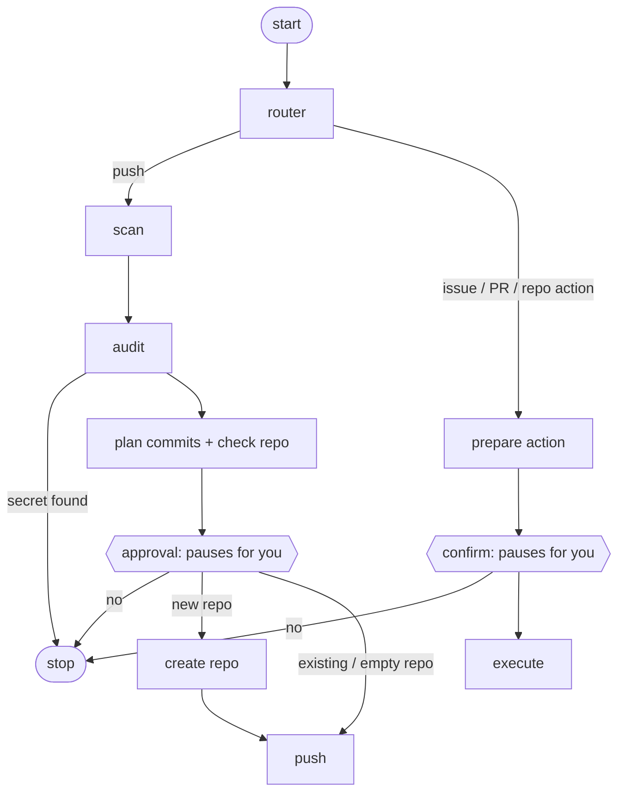

# GitHub Agent

A command-line agent, built with [LangGraph](https://langchain-ai.github.io/langgraph/), that handles everyday GitHub chores for you. Give it a folder or a single file and it checks the project, shows you a plan, and pushes it. It can also create repos, open issues and pull requests, and archive or delete repos, always behind a confirmation step.

> Status: personal project, work in progress.

## What it does

| You say | The agent does |
|---|---|
| Push a folder or file to a repo that doesn't exist | Audits it, asks private or public, creates the repo, pushes to `main` |
| Push to an empty repo | Audits it, pushes to `main` |
| Push to a repo that already has commits | Pushes to a new `agent/update-<timestamp>` branch and opens a pull request. `main` is never touched |
| Create a repo | Creates an empty repo (you choose private or public) |
| Create an issue | Opens it with the title and body you give |
| Open a pull request | Opens a PR between two existing branches |
| Archive a repo | Makes it read-only (you must type the repo name) |
| Delete a repo | Disabled by default; see [Safety](#safety) |

## How it works



- **scan** lists the files to push and skips virtual environments, caches, secret files (`.env`, keys, Google OAuth files) and anything over GitHub's 100 MB limit.
- **audit** looks for secrets inside files, hardcoded personal paths, missing README / `.gitignore` / LICENSE / requirements, and imports that aren't in `requirements.txt`. A leaked key stops the run.
- **plan** groups the files into a few logical commits and checks whether the target repo exists, is empty, or already has history.
- **approval / confirm** use LangGraph's `interrupt()`: the graph pauses, shows exactly what will happen, and resumes only with your answer.
- **push** works in a temporary folder, so the project you scanned is never modified.

## Requirements

- Python 3.10 or newer
- `git` on your PATH
- A GitHub personal access token (see below)

```
pip install langgraph pyyaml python-dotenv
```

## Setup

1. Create a **fine-grained personal access token** on GitHub with repository access set to **All repositories** and these permissions:
   - Contents: read and write
   - Metadata: read
   - Issues: read and write
   - Pull requests: read and write
   - Administration: read and write (needed to create, archive and delete repos)

   Administration is powerful: with it the token can also delete repos. Leave it out if you only want to push to repos you create by hand.

2. Create a `.env` file next to `graph.py`:

   ```
   GITHUB_TOKEN=your-token
   GITHUB_USERNAME=your-github-username
   ```

   Optional settings:

   ```
   GIT_AUTHOR_NAME=Your Name
   GIT_AUTHOR_EMAIL=you@example.com
   PROTECTED_REPOS=repo-one,repo-two
   ALLOW_DELETE=1
   ```

   Commits only count toward your GitHub contribution graph if the commit email belongs to your account. If you don't set `GIT_AUTHOR_EMAIL`, your global git email is used.

3. Keep `.env` out of git. This repo's `.gitignore` should contain:

   ```
   .env
   venv/
   __pycache__/
   agent_log.jsonl
   ```

## Usage

Run from the project folder, with the virtual environment active:

```
python graph.py "push 'C:\path\to\project' to repo my-project"
python graph.py "push 'C:\path\to\file.py' to repo my-project"
python graph.py "create a private repo called my-project"
python graph.py "create an issue in repo my-project titled 'Add tests' with body 'Needs pytest'"
python graph.py "open a pull request in repo my-project from feature-x into main titled 'Add feature'"
python graph.py "archive repo old-project"
python graph.py "delete repo old-project"
```

There is also a short form for pushes:

```
python graph.py "C:\path\to\project" "my-project"
```

**Phrasing tips.** Put paths and titles in quotes, and say `repo NAME` before the repo name. Use hyphens in repo names, not spaces. The request parser is rule-based, so it understands the phrasings above and shows examples if it can't tell what you meant.

### What the prompts look like

- Existing repo: `Approve? (yes/no)`
- New repo: type `private` or `public`. This both approves and sets the visibility. Anything else cancels.
- Archive or delete: type the exact name shown. Anything else cancels.

## Safety

- **Nothing is pushed without your approval**, and the plan (files, commits, target repo, branch) is shown first.
- **Secrets stay out.** Secret-like files are skipped, and the audit blocks the push if it finds API keys or tokens inside any file. Matches are masked in the output.
- **Existing repos get a pull request**, never a direct push to `main`.
- **The token is never written into git config or the remote URL.** It is passed to git as an HTTP header through environment variables and scrubbed from error messages.
- **Deleting is deliberately hard.** It needs `ALLOW_DELETE=1` in `.env`, the repo must not be listed in `PROTECTED_REPOS`, and you must type the full `owner/name`. Prefer archiving when unsure.
- **Every action is logged** to `agent_log.jsonl`, with no secrets in it.

## Project layout

| File | Purpose |
|---|---|
| `graph.py` | Builds the LangGraph graph and runs the interactive loop |
| `state.py` | The shared state passed between nodes |
| `intent.py` | Turns a plain-English request into an action (router) |
| `scanner.py` | Chooses which files are pushed |
| `audit.py`, `rules.yaml` | Project checks; the checklist lives in `rules.yaml` |
| `approval.py` | Approval step for pushes |
| `push.py` | Commit planning, repo creation, and pushing |
| `actions.py` | Issues, pull requests, archive, delete |
| `github_api.py` | Small GitHub REST client and the action log |
| `policy.py` | Which actions need which kind of confirmation |

## Limitations

- Files land at the **root** of the repo. Pushing into a subfolder isn't supported yet.
- Updates only **add or change** files. Files you deleted locally stay in the repo.
- The scanner uses its own ignore rules and does not read your project's `.gitignore`.
- Issues are created with a title and body only (no labels or assignees yet).
- The request parser is rule-based, not an LLM.

## Author

Shubh Sharma ([@neural-shubh](https://github.com/neural-shubh))

## License

Not specified yet. Add a `LICENSE` file before sharing this publicly.
